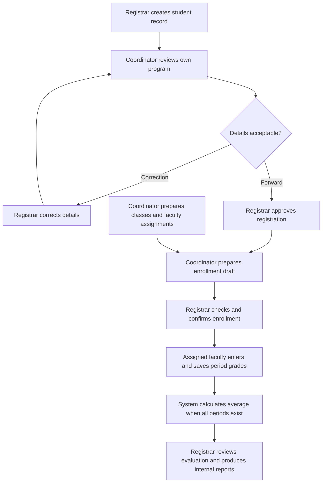

# Roles and academic workflow

Each account has one staff role. Administrator access does not include registrar permissions. The same rules apply in authenticated services and navigation; hiding a button is not the security boundary.

| Role | Pages | Allowed work |
|---|---|---|
| Administrator | Staff accounts, Access requests, Password assistance, Audit history | Manage staff access and inspect recorded activity. No student, enrollment, grade, curriculum or teaching-assignment access. |
| Registrar | Workspace, Students, Registration approvals, Enrollment, Evaluation, Reports | Create and correct student details, give final registration approval after program review, prepare/check and confirm enrollment, review saved academic results and produce internal reports. No grade entry or faculty loading. |
| Program coordinator | My workspace, Pending students, Students, Enrollment drafts, Faculty loading, Evaluation | Review their own program, request corrections or forward registration, prepare enrollment drafts, maintain faculty profiles and program-specific teaching assignments. Student details are read-only; registration decisions start from the review queue. Cannot confirm enrollment or save grades. |
| Faculty | My classes, Grade entry, Computed grades | Enter period grades for assigned classes and inspect read-only computed results. Cannot open full student personal records, manage accounts or enroll students. |

There are separate BSIT and BSBA coordinator roles. Faculty access follows the assigned faculty identifier, not a program-wide grant. Faculty profiles are a shared directory; teaching assignments and coordinator student access are scoped by program. Every role has Change password and Sign out.

## Academic workflow

Staff access follows a separate path: staff requests access, administrator verifies and assigns a role (and faculty identifier where needed), staff signs in, and services check current account status and authorized scope on each operation. Administrators review the recorded audit events.

## Demo accounts

This machine's presentation demo has explicitly provisioned accounts named `demo.admin`, `demo.registrar`, `demo.bsit`, `demo.bsba`, `demo.faculty.it`, and `demo.faculty.ba`. The faculty accounts link to `SAMPLE-FAC-BSIT` and `SAMPLE-FAC-BSBA` respectively. Faculty rosters populate after the coordinator creates assignments and the registrar confirms enrollment.

Generated passwords are kept locally in ignored `artifacts/demo/presentation/ROLE-ACCOUNTS.md`; they are not distributed in Git. These accounts belong to the presentation demo only. Fresh installations still have no default credentials, and a demo reset replaces its active account database. Existing main and demo accounts were not reset by this revision.

## Limits

Only assigned faculty can routinely save grades. A submitted-grade locking and correction-approval workflow is not implemented; it requires school-approved rules. Account administration can assign roles, so it remains a trusted responsibility, but does not provide direct academic editing. Local Access files can still be changed outside the application by a person with filesystem access. Azure authorization and a student portal remain future work.
